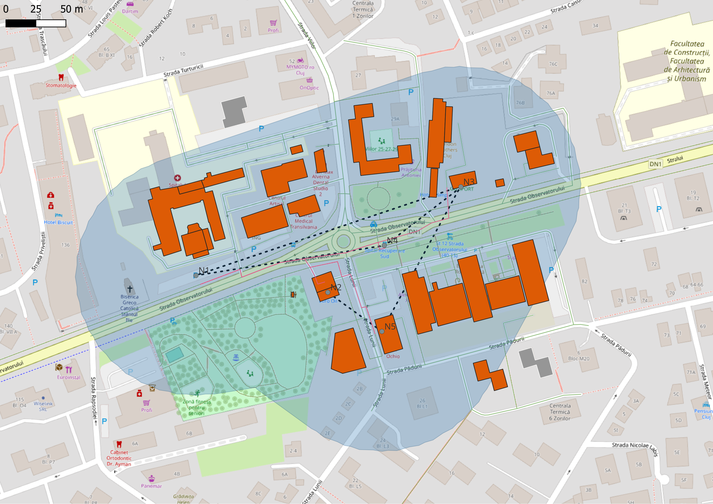

# Fiber Route Planning – Cluj-Napoca (QGIS)

A small fixed-network planning exercise: connecting a central node to four points of interest over the real street network, then estimating cable length, trench length and the number of buildings along the route.

## Goal

Practice the basic workflow of fiber-to-the-home (FTTH) route planning: route design on a road network, length calculation and a first estimate of the area served.

## Data

- Street network and buildings: © OpenStreetMap contributors, downloaded with the QuickOSM plugin (October 2026), area: Zorilor, Cluj-Napoca.
- Coordinate system: EPSG:3844 (Stereo 70), so lengths are in meters.
- Nodes: 5 points marked by hand (N1 central node; N2 gas station, N3 sports hall, N4 bus stop, N5 supermarket).

## Method

1. Downloaded streets (`highway`) and buildings (`building`) with QuickOSM and reprojected both to EPSG:3844.
2. Created a point layer for the nodes in a GeoPackage.
3. Ran *Shortest path (point to layer)* from N1 to N2–N5 on the street network (star topology).
4. Summed the route lengths (cable) and dissolved the routes to measure the unique trench length.
5. Buffered the dissolved routes by 100 m and selected the building polygons that intersect the buffer.
6. Produced the map layout and exported it to PDF.

## Results

| Metric | Value |
|---|---|
| Nodes | 5 (1 central + 4 destinations) |
| Total cable length | ≈ 750 m |
| Unique trench length (overlaps removed) | ≈ 667 m |
| Buildings within 100 m of the route | 31 <!-- verify against your final layer --> |

Overlapping routes save about 84 m (≈ 11%) compared with laying every cable in its own trench.

Full map: [maps/plan_fibra.pdf](maps/plan_fibra.pdf)

## Assumptions and limitations

- Star topology from a single central node; a minimum-trench design (minimum spanning tree) would likely be cheaper.
- Routes follow public streets only, with no real-world constraints (duct availability, permits, crossings, terrain).
- The count is of **buildings**, not homes. Real FTTH planning counts homes passed, and one apartment block holds many homes.
- Node positions are illustrative.
- OpenStreetMap data can be incomplete or outdated.

## Next steps

- Compute a minimum spanning tree over the road network in Python (`osmnx`, `networkx`) and compare it with the star design.
- Estimate homes passed instead of buildings.

## Files

- `README.md` this file
- `maps/plan_fibra.pdf` final map
- `qgis/fibra_cluj.qgz` QGIS project
- `qgis/fibra.gpkg` layers (nodes, routes, buffer, selected buildings); keep it in the same folder as the project so the layers open without broken links

## Tools

QGIS (Processing: Shortest path, Dissolve, Buffer, Extract by location), QuickOSM, OpenStreetMap.
